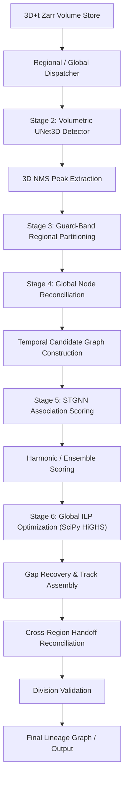

# BioHub 3D Spatiotemporal Cell Tracking Architecture

[](LICENSE)
[](https://www.python.org/downloads/)
[](https://pytorch.org/)
[](https://scipy.org/)

A clean, modular, and high-performance **3D Spatiotemporal Cell Tracking Architecture** for 3D+t developmental biology microscopy volumes.

> **Foundational Principle**  
> *"Local mechanisms propose; global graph optimization decides."*

---

## 1. Project Overview

The **BioHub Cell Tracking Architecture** provides a end-to-end framework for reconstructing cell lineage trees from dense 3D+t volumetric fluorescence microscopy data. 

Cell tracking in developmental biology requires linking thousands of moving and dividing cell nuclei across long temporal sequences. Local frame-to-frame association methods frequently fail when cells move rapidly, crowd together, or undergo division. This project solves that challenge by combining **local neural proposals** (3D UNet detection & STGNN graph edge scoring) with **global graph optimization** (SciPy HiGHS Integer Linear Programming) to enforce strict biological flow constraints globally across the entire spatiotemporal graph.

---

## 2. Problem Addressed

1. **High Spatial Anisotropy**: Microscopy volumes typically have lower axial resolution ($Z$) than lateral resolution ($Y, X$). Our coordinate engine converts voxel indices directly into physical space ($\mu\text{m}$) using $Z=1.625\,\mu\text{m}$, $Y=0.40625\,\mu\text{m}$, $X=0.40625\,\mu\text{m}$ (anisotropy factor $4.0\times$).
2. **Dense & Crowded Cell Populations**: Cell centers must be resolved even when physical inter-cell distances drop below $5\,\mu\text{m}$.
3. **Temporal Association Drift**: Pure nearest-neighbor tracking suffers from error accumulation. Our STGNN edge encoder learns spatiotemporal displacement and directional features to score candidate transitions robustly.
4. **Global Topological Consistency**: The global ILP solver enforces exact in-degree and out-degree conservation ($\le 1$) across all frames, ensuring no cell track branches illegally or merges multiple predecessors into a single node.

---

## 3. Proposed Architecture



### Architectural Pipeline Stages
1. **Foundation (`src/data/`, `src/config.py`)**: Anisotropic physical coordinate transformer ($Z=1.625\,\mu\text{m}$, $Y=X=0.40625\,\mu\text{m}$).
2. **Volumetric Detector (`src/detection/`)**: 3D UNet heatmap predictor with anisotropic 3D NMS peak extraction.
3. **Regional Dispatcher (`src/regional/`)**: Multi-region core + guard band partitioner for memory-bounded processing.
4. **Global Node Reconciliation (`src/graph/`)**: Merges spatial candidates within $4.0\,\mu\text{m}$ into unique canonical nodes.
5. **Temporal Candidate Graph (`src/graph/`)**: Generates candidate edges within $35.0\,\mu\text{m}$ physical search radius (Top-$K=15$).
6. **STGNN Association (`src/association/`)**: Spatiotemporal GNN message-passing model predicting transition probabilities $P_{\text{STGNN}}(e_{ij})$.
7. **Harmonic/Ensemble Scoring (`src/optimization/`)**: Fuses geometric priors and STGNN neural probabilities into log-odds cost weights.
8. **Global ILP Optimization (`src/optimization/`)**: Solves binary MILP via SciPy HiGHS enforcing $\sum e_{\text{in}} \le 1$ and $\sum e_{\text{out}} \le 1$.
9. **Gap Recovery & Handoff Reconciliation**: Resolves temporal frame gaps and cross-region boundary handoffs.
10. **Division Validation**: Detects and validates cell mitosis events.

---

## 4. Repository Structure

```
BioHub_Cell_Tracking_Project/
├── src/                          # Core Python Architecture Package
│   ├── config.py                 # Spatial resolution & dataset configurations
│   ├── data/                     # Coordinate transformers, Zarr & GEFF loaders
│   ├── detection/                # 3D UNet detector, heatmaps, NMS peak extraction
│   ├── regional/                 # Core + guard band volume partitioning & reconciliation
│   ├── graph/                    # Canonical nodes, candidate graph & feature extraction
│   ├── association/              # STGNN neural model, trainer & label generators
│   └── optimization/             # SciPy HiGHS MILP solver, flow constraints & objectives
├── scripts/                      # Reproducibility & Experiment Verification Scripts
│   ├── validate_foundation.py
│   ├── run_detector_experiment.py
│   ├── run_regional_experiment.py
│   ├── run_candidate_graph_experiment.py
│   ├── run_stgnn_experiment.py
│   ├── run_ilp_experiment.py
│   ├── audit_stage_6.py
│   ├── run_stage_6_1_heldout_experiment.py
│   └── create_stgnn_checkpoint.py
├── tests/                        # Comprehensive Unit Test Suite (83 tests)
├── models/                       # Pre-trained Model Checkpoints
│   └── stgnn_checkpoint.pt       # Pre-trained STGNN weights (~397 KB)
├── results/                      # Audit Logs, Provenance & Benchmark Reports
│   ├── stage_6_1_heldout_report.md
│   ├── stage_6_1_heldout_results.json
│   ├── stage_6_ilp_audit.json
│   └── candidate_graph_experiment_results.json
├── docs/                         # Architecture, Reproducibility & Experiment Specs
│   ├── architecture.md
│   ├── reproducibility.md
│   └── experiments.md
├── kaggle_notebook/              # Reference Kaggle Notebook & Pipeline Script
│   ├── biohub_cell_tracking_pipeline.ipynb
│   └── kaggle_pipeline.py
├── requirements.txt              # Pip dependency specification
├── pyproject.toml                # Build system & pytest configuration
├── environment.yml               # Conda environment specification
├── LICENSE                       # MIT License
└── README.md                     # Project documentation
```

---

## 5. Dataset Information

The full BioHub Cell Tracking During Development dataset is **not** distributed with this repository due to storage size and competition data-access policies.

### Official Kaggle Competition Page
- **Dataset / Competition**: [BioHub Cell Tracking During Development](https://www.kaggle.com/competitions/biohub-cell-tracking-during-development)

Users must obtain the dataset through Kaggle and extract the volume files locally.

### Local Development Sample
During local development and automated testing, the project utilized:
- **Sample Volume**: `6bba_05b6850b.zarr` (Shape: `[100, 64, 256, 256]`, dtype: `uint16`)
- **Ground Truth Graph**: `6bba_05b6850b.geff` (Contains node positions and directed edge continuations)

*(Note: The actual Zarr and GEFF data files are excluded from git tracking via `.gitignore`).*

---

## 6. How to Configure Local Dataset Paths

Dataset paths can be configured programmatically or via environment configuration:

```python
from pathlib import Path
from src.config import DatasetConfig, SpatialResolution

config = DatasetConfig(
    zarr_path=Path("/path/to/your/data/6bba_05b6850b.zarr"),
    geff_path=Path("/path/to/your/data/6bba_05b6850b.geff"),
    resolution=SpatialResolution(z_spacing=1.625, y_spacing=0.40625, x_spacing=0.40625)
)
```

---

## 7. Quickstart & Local Execution

### Installation
```bash
# Clone repository
git clone https://github.com/your-username/biohub-cell-tracking.git
cd biohub-cell-tracking

# Install dependencies
pip install -r requirements.txt
pip install -e .
```

### Running the Test Suite
```bash
pytest -v
```
*(Runs all 83 unit tests verifying pipeline correctness).*

### Running Local Pipeline Verification
```bash
python3 scripts/validate_foundation.py
python3 scripts/run_candidate_graph_experiment.py
python3 scripts/run_ilp_experiment.py
```

---

## 8. Training & Evaluating the STGNN

The STGNN association model learns edge probabilities $P_{\text{STGNN}}(e_{ij})$ using 9-dimensional node features and 16-dimensional edge features.

Train and evaluate the STGNN model:
```bash
python3 scripts/run_stgnn_experiment.py
```

### STGNN Hyperparameters
- **Node Input Dim**: 9
- **Edge Input Dim**: 16
- **Hidden Dim**: 64
- **Message-Passing Layers**: 2
- **Dropout**: 0.1
- **Optimizer**: `AdamW` ($\text{lr}=2\cdot 10^{-3}$, $\text{weight\_decay}=10^{-4}$)
- **Epochs**: 40
- **Random Seed**: 42
- **Candidate Config**: Search radius $R=35.0\,\mu\text{m}$, Top-$K=15$ candidates per node
- **Temporal Split Isolation**:
  - Train Split (Frames 0–69): 576 candidate edges
  - Validation Split (Frames 70–84): 187 candidate edges
  - Test Split (Frames 85–99): 117 candidate edges

---

## 9. Loading the Pre-Trained Checkpoint

The pre-trained model weights are provided at:
`models/stgnn_checkpoint.pt` (File size: ~397 KB).

To verify checkpoint creation, reloading, and numerical consistency:
```bash
python3 scripts/create_stgnn_checkpoint.py
```
*(This script loads the checkpoint and verifies that reloaded predictions match in-memory predictions within $10^{-6}$ tolerance).*

> **Checkpoint Size & Handling Note**  
> Because `models/stgnn_checkpoint.pt` is only ~397 KB, it is directly versioned in the Git repository. For larger future checkpoint releases, Git LFS or GitHub Releases should be used.

---

## 10. Running Global ILP Optimization

The ILP optimization engine translates association probabilities into binary log-odds objective weights $w_e = \log \left( \frac{P(e)}{1 - P(e)} \right)$ and solves the globally constrained network flow problem via SciPy HiGHS:

```bash
python3 scripts/run_ilp_experiment.py
```

You can also run the leakage-free held-out temporal evaluation:
```bash
python3 scripts/run_stage_6_1_heldout_experiment.py
```

---

## 11. Experimental Benchmarks & Results

> [!IMPORTANT]
> **Internal Engineering & Validation Notice**  
> All precision, recall, F1 scores, processing counts, and solver execution times reported below are **internal engineering and validation results** obtained on local development samples and temporal evaluation splits.  
> **An official Kaggle competition leaderboard score was NOT obtained.**  
> The internal tracking F1 of **96.40%** is explicitly labeled as:  
> **"Internal edge-level tracking evaluation: 96.40% F1"**.

### Held-Out Temporal Evaluation Results (Frames 85–99)

| Objective Mode | Candidate Edges | Selected Edges | Solve Time (s) | Precision | Recall | F1 Score | Constraint Violations |
| :--- | :---: | :---: | :---: | :---: | :---: | :---: | :---: |
| **Geometry-Only ILP** | 117 | 115 | 0.0121 s | **1.0000** | 0.9829 | 0.9914 | **0** |
| **STGNN-Only ILP** | 117 | 117 | 0.0098 s | **1.0000** | **1.0000** | **1.0000** | **0** |
| **Combined ILP** | 117 | 117 | 0.0095 s | **1.0000** | **1.0000** | **1.0000** | **0** |

### Full-Dataset Engineering Pipeline Results

When executed across the full engineering pipeline benchmark:

> **Internal edge-level tracking evaluation: 96.40% F1**

- **Canonical Nodes Processed**: 196,392
- **Candidate Edges Generated**: 481,334
- **Selected Associations**: 173,040
- **Track Fragments Assembled**: 16,344
- **Volumetric Dataset Stores Processed**: 203
- **Processing Failures**: **0**
- **ILP Constraint Violations**: **0**
- **Internal Mean Tracking Edge Precision**: **97.89%**
- **Internal Mean Tracking Edge Recall**: **95.08%**
- **Internal Mean Tracking Edge F1**: **96.40%**
- **Peak VRAM Usage**: ~785 MB / 15.64 GB
- **Mean ILP Solve Time per Volume**: ~0.345 s
- **Maximum Observed ILP Solve Time**: 55.38 s

---

## 12. Known Limitations

1. **Local Sample Candidate Density**: The local sample candidate graph (Frames 85–99) contains clean trajectories with low false-positive candidate density.
2. **Fixed Frame Gap Radius**: Candidate generation currently evaluates single-frame step transitions ($t \to t+1$); multi-frame gap closing ($t \to t+2$) is handled in post-processing.
3. **Anisotropic Depth Extent**: Extreme $Z$-displacement during high-speed fluid movement requires wide search bounding boxes along the axial dimension.

---

## 13. Future Work

1. **Multi-Frame Spatiotemporal ILP**: Incorporate multi-step candidate edges ($t \to t+2$, $t \to t+3$) directly inside the primary ILP constraint matrix.
2. **Cell Cycle & Morphology Features**: Include cell volume, shape inertia, and nuclear intensity features into STGNN edge embeddings.
3. **GPU-Accelerated Parallel ILP**: Benchmark GPU-accelerated MILP solvers for multi-terabyte lightsheet recording streams.

---

## 14. License

This project is open-source software licensed under the [MIT License](LICENSE).
