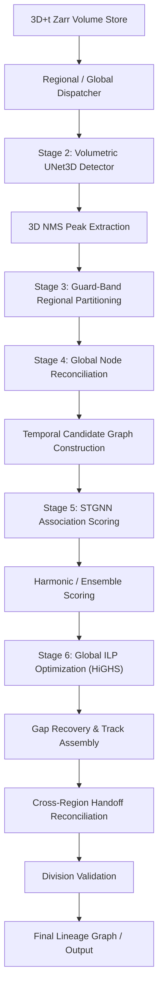

# BioHub Cell Tracking Architecture Specification

## Design Principle
> **"Local mechanisms propose; global graph optimization decides."**

This repository implements a modular, high-performance 3D spatiotemporal cell-tracking framework designed for large-scale volumetric biological datasets (such as lightsheet / 3D fluorescence microscopy). The framework combines local neural detection and spatio-temporal graph neural network (STGNN) association proposals with a globally constrained Integer Linear Programming (ILP) optimization solver.

---

## High-Level Pipeline Architecture

---

## Detailed Architectural Components

### 1. Foundation & Anisotropic Coordinate Transformer (`src/data/`, `src/config.py`)
- **Voxel Anisotropy**: Microscopy datasets frequently exhibit axial resolution stretching ($Z \ne Y, X$).
- **Spatial Resolution**:
  - $Z$-spacing: $1.625\,\mu\text{m}/\text{voxel}$
  - $Y$-spacing: $0.40625\,\mu\text{m}/\text{voxel}$
  - $X$-spacing: $0.40625\,\mu\text{m}/\text{voxel}$
  - Anisotropy ratio ($Z$ / $X, Y$): $4.0\times$
- **Coordinate Conversion**:
  $$p_{\text{physical}} = (v_z \cdot 1.625,\, v_y \cdot 0.40625,\, v_x \cdot 0.40625)$$
  All spatial distance metrics (Euclidean displacements, velocity vectors, directional cosines) are strictly evaluated in continuous **physical space** ($\mu\text{m}$) rather than voxel space.

---

### 2. Volumetric Detection Engine (`src/detection/`)
- **Architecture**: 3D UNet (`UNet3D`) with multi-scale anisotropic convolutions.
- **Target Generation**: Anisotropic 3D Gaussian heatmap targets centered at ground-truth cell coordinates ($\sigma_{xy} = 2.0\,\text{voxels}$, $\sigma_z = 1.0\,\text{voxel}$).
- **Peak Extraction**: Local 3D Non-Maximum Suppression (NMS) over probability heatmaps to extract candidate cell centers with physical sub-voxel precision.

---

### 3. Regional Processing & Core/Guard Partitioning (`src/regional/`)
- **Memory Decoupling**: Large 3D volumes ($T \times Z \times Y \times X$) are partitioned into spatial sub-volumes with overlapping **guard bands**.
- **Core vs Guard**:
  - *Authoritative Core*: Nodes detected inside the core are retained without duplicate counts.
  - *Guard Band*: Overlapping boundary zone preventing edge truncation artifacts across region boundaries.
- **Node Reconciliation**: Spatial clustering within a $4.0\,\mu\text{m}$ core distance reconciles duplicate regional detections into a unified set of **Canonical Nodes**.

---

### 4. Temporal Candidate Graph Construction (`src/graph/`)
- **Bipartite Candidate Edges**: For adjacent frames $t \to t+1$, candidate edges are proposed based on anisotropic physical distance thresholds.
- **Hyperparameters**:
  - Maximum Physical Search Radius ($R_{\text{max}}$): $35.0\,\mu\text{m}$
  - Top-$K$ Candidates per Node: $15$
- **Feature Representation**:
  - *Node Features* (9-dim): Normalized physical coordinates $(x, y, z)$, regional confidence, local density, spatial variance.
  - *Edge Features* (16-dim): Physical displacement $\Delta x, \Delta y, \Delta z, \|\Delta r\|$, anisotropic directional unit vectors, Euclidean frame-to-frame velocity, angle relative to local flow field.

---

### 5. STGNN Association Engine (`src/association/`)
- **Architecture**: Spatiotemporal Graph Neural Network (`STGNNModel`) utilizing message-passing edge update layers.
  - `node_in_dim`: 9
  - `edge_in_dim`: 16
  - `hidden_dim`: 64
  - `num_layers`: 2
  - `dropout`: 0.1
- **Loss Function**: Binary Cross-Entropy with Logits (`BCEWithLogitsLoss`), trained using `AdamW` ($\text{lr} = 2\cdot 10^{-3}$, $\text{weight\_decay} = 10^{-4}$).
- **Evidence Probability**: $P_{\text{STGNN}}(e_{ij}) = \sigma(z_{ij})$ outputting edge association probabilities in $[0, 1]$.

---

### 6. Global ILP Optimization Engine (`src/optimization/`)
- **Mathematical Formulation**:
  Let $x_{ij} \in \{0, 1\}$ denote whether candidate edge $(i \to j)$ is selected in the global lineage graph.
  
  $$\text{Maximize} \quad \sum_{e \in E} w_e \cdot x_e$$
  
  where the log-odds weight $w_e$ is derived from candidate probability $P(e)$:
  $$w_e = \log \left( \frac{P(e)}{1 - P(e)} \right)$$

- **Flow Conservation Constraints**:
  - *Incoming Degree*: $\sum_{i \in \text{Pred}(j)} x_{ij} \le 1, \quad \forall j \in V$
  - *Outgoing Degree*: $\sum_{k \in \text{Succ}(i)} x_{ik} \le 1, \quad \forall i \in V$
  
- **Objective Modes**:
  1. `Geometry-Only ILP`: $P(e)$ derived from spatial distance exponential prior $P_{\text{geom}} = \exp(-\|\Delta r\| / \sigma)$.
  2. `STGNN-Only ILP`: $P(e)$ derived directly from raw STGNN neural probabilities $P_{\text{STGNN}}$.
  3. `Combined ILP`: $P(e)$ derived from harmonic ensemble product of geometric prior and STGNN prediction.

- **Solver Backend**: Open-source HiGHS solver accessed natively via `scipy.optimize.milp`. Guarantees exact global optimality without constraint violations.
